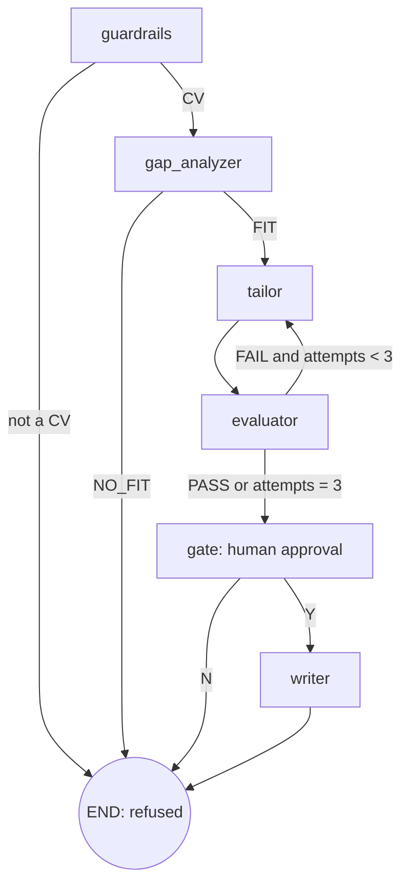

# CV Tailor Agent

An LLM agent that tailors a CV to a job description. It analyzes the match, rewrites the CV using only facts from the original, checks the rewrite, and saves a Word file only after you approve it.

## What it does

1. **Guardrails:** checks that the first input is a CV, and that both inputs are not empty.
2. **Gap analyzer:** checks that the CV fits the job's field. If not, the run stops and nothing is saved.
3. **Tailor:** rewrites the CV, using writing guidelines retrieved from `agent/knowledge/`.
4. **Evaluator:** checks that every fact in the rewrite appears in the original. Up to three attempts.
5. **Gate:** shows the result and asks `Save the new version? [Y/N]`.
6. **Writer:** saves a `.docx` file.

## Requirements

- Windows, Python 3.11 or newer (tested with 3.14)
- An OpenRouter API key
- A LangSmith API key (optional, for tracing)

## Setup

```
py -3.14 -m venv .venv
.venv\Scripts\activate
pip install -r requirements.txt
copy .env.example .env
```

Then edit `.env` and add your keys:

```
OPENROUTER_API_KEY=sk-or-...
LANGSMITH_API_KEY=lsv2_...
LANGSMITH_TRACING=true
LANGSMITH_PROJECT=cv-tailor-agent
MODEL_NAME=google/gemma-4-31b-it
```

`MODEL_NAME` is optional. The default is `anthropic/claude-sonnet-5`.

## Running

From the project root:

```
python -m agent.cli
```

At the prompt, paste the path to your CV (`.txt` or `.docx`). Then enter the job description, either as a file path or as text, and choose where to save the result.

To run the packaged version, put `.env` next to `agent.exe` and run it from a terminal:

```
dist\agent.exe
```

## Evaluations

| Command | What it measures |
|---|---|
| `python -m evals.check_connection` | The model connection works |
| `python -m evals.scope_eval` | The agent refuses requests that are not CVs |
| `python -m evals.cost_eval` | Tokens and cost per step, per sample |
| `python -m evals.compare_models` | Speed and judge score across models |

The judge uses the criteria in `evals/rubric.md`. Samples are synthetic, in `evals/samples.py`.

## Building the exe

```
pip install pyinstaller
build.bat
```

The exe is created in `dist\agent.exe`.

## Architecture

The agent is a LangGraph `StateGraph`. Each node reads and writes fields of a shared `AgentState`, and conditional edges decide the next step.



### Nodes

| Node | Role |
|------|------|
| `guardrails` | Checks that both inputs are non-empty and that the first input is a CV. Off-topic input is refused here. |
| `gap_analyzer` | Compares the CV with the job description and returns FIT or NO_FIT. A NO_FIT result stops the run with an error and nothing is saved. |
| `tailor` | Rewrites the CV in the same language, using only facts from the original. It retrieves writing guidelines from the knowledge base (RAG) and adds the evaluator's feedback when retrying. |
| `evaluator` | Checks the rewrite for relevance, factual accuracy, completeness and format, and returns PASS or FAIL with feedback. |
| `gate` | Pauses the graph with `interrupt()` and shows the proposed CV. The user answers Y or N. |
| `writer` | Builds the Word (.docx) file with headings, bullets and right-to-left formatting for Hebrew. |

### State

`AgentState` holds: `cv_text`, `job_text`, `analysis`, `tailored`, `eval_passed`, `eval_feedback`, `attempts`, `approved`, `output_path`, `error`, and `usage` (token counts per node).

### Key design decisions

- **Human in the loop.** The `gate` node uses LangGraph `interrupt()` and resumes with `Command(resume=...)`. A `MemorySaver` checkpointer keeps the state between the pause and the resume.
- **Self-correction loop.** A failed evaluation sends the CV back to `tailor` with feedback, up to 3 attempts. After that, the best version goes to the user for approval.
- **Scope control.** Two checks prevent misuse: `guardrails` rejects input that is not a CV, and `gap_analyzer` rejects a CV that does not match the job.
- **Retrieval (RAG).** The knowledge base is `agent/knowledge/cv_guidelines.txt`. `agent/tools.py` scores paragraphs by shared words with the query and returns the top matches.
- **Model provider.** All model calls go through OpenRouter using `langchain_openai.ChatOpenAI` with the OpenRouter base URL. The model is set with `MODEL_NAME`.
- **Observability.** LangSmith traces every run when `LANGSMITH_TRACING=true`.
- **Cost tracking.** Each node records token usage from `usage_metadata`. The CLI prints the cost per node and the total using `agent/pricing.py`.

## Project structure

```
agent/
  cli.py           command-line interface
  graph.py         state and workflow
  nodes.py         the agent's steps
  pricing.py       model prices
  tools.py         retrieval from the knowledge file
  knowledge/       writing guidelines used by retrieval
evals/             evaluation scripts, rubric and samples
manifest.json      agent description
run_agent.py       entry point for the exe
build.bat          builds the exe
```

## Privacy

The agent sends the CV and the job description to the model provider through OpenRouter. Do not use real personal data in the evaluation samples. Keep `.env` out of version control.
